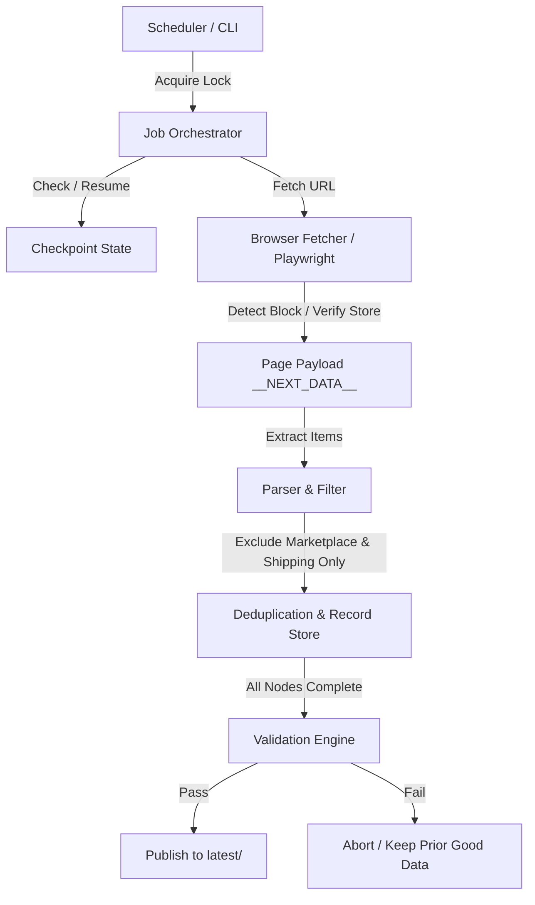

# Architecture Design Document - Walmart Scraper

**Author:** [Zulqarnain Ahmad](https://www.freelancer.com/u/zulqarnaina43)  
**In collaboration with team leader:** [Afaq Ahmad](https://www.freelancer.com/u/AFAQCEO) ([GitHub](https://github.com/H-tech-AFAQ-CEO))

---

## 1. System Architecture
The Walmart Scraper is designed around a modular, resilient pipeline that separates fetching, parsing, validation, and storage.

## 2. Component Breakdown
- **`__main__.py` & `runner.py`**: CLI entry point and orchestrator (`Job` class). Manages locking, discovery, scraping, UPC enrichment, validation, and atomic publishing.
- **`fetcher.py`**: Playwright-based browser automation (`BrowserFetcher`). Handles store cookie seeding, store selector interaction, lazy-loading scroll, and bot detection (`classify`).
- **`parser.py`**: Deep-finds items in Walmart's `__NEXT_DATA__`, extracts store context, checks local pickup fulfillment, parses pricing, weight, ppm, deals, and filters sponsored items.
- **`deals.py`**: Classifies promo text into volume vs. digital deals while preserving exact wording.
- **`validate.py`**: Enforces strict invariants (yield ratio vs prior run, canary products, completeness ≥98%, no approximate weights, no gupc/unit_price).
- **`storage.py`**: Abstraction supporting local filesystem (`LocalStorage`) and Azure Blob Storage (`AzureBlobStorage`) with managed identity and distributed blob lease locking.
- **`checkpoint.py`**: Stores node progress, counters, events, and records for resumability.

## 3. Data Integrity & Safety Invariants
1. **Never Overwrite Good Data**: Runs write to `runs/<job>/<run_id>/`. `latest/<job>/` is updated only if validation succeeds (`publish_latest`).
2. **Strict Verification**: Location mismatch or store verification failure aborts the run instantly.
3. **Marketplace & Shipping Exclusions**: Only Walmart-sold items with local pickup/in-store fulfillment are kept.
4. **No Price Calculation**: Deal prices and PPM are extracted as displayed; never computed.
